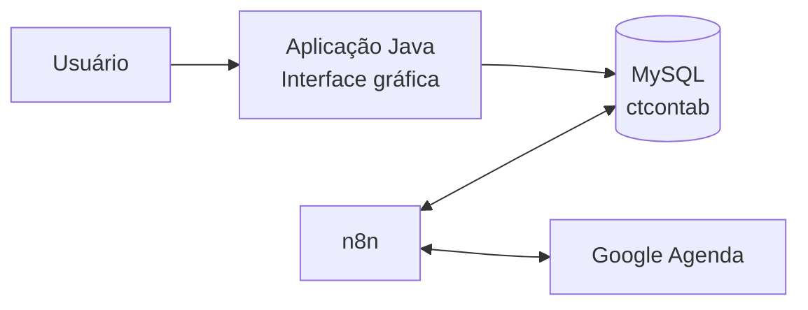

<div align="center">


[Visão geral](#visão-geral) ·
[Funcionalidades](#funcionalidades) ·
[Arquitetura](#arquitetura) ·
[Modelo de dados](#modelo-de-dados) ·
[Instalação](#instalação) ·
[Equipe](#equipe)

</div>

---

## Visão geral

O Client Manager é uma aplicação desktop em Java, com interface gráfica e banco de dados MySQL, que centraliza a operação diária de um escritório de contabilidade: cadastro de clientes, acompanhamento de serviços, distribuição de tarefas, agenda de compromissos e geração de relatórios.

O projeto foi desenvolvido ao longo de 1 ano e meio como trabalho acadêmico, com a CT Contab como caso de uso. Desde o início foi tratado como um produto real, com modelagem de banco, controle de acesso e rastreabilidade das ações dos usuários.

### Motivação

Em um escritório de contabilidade, as informações de clientes, prazos e responsáveis costumam ficar distribuídas em planilhas, agendas e conversas. Isso dificulta saber o estado de cada serviço, quem é responsável por ele e o que mudou. O objetivo do sistema é reunir esses dados em um único lugar, com permissões por perfil e histórico de ações.

## Funcionalidades

| Módulo | Descrição | Objetivo |
| --- | --- | --- |
| **Clientes** | Cadastro, edição, exclusão e busca. Registra tipo de pessoa (física, jurídica ou não informado), contatos, serviço contratado, situação do serviço e usuário que realizou o cadastro. | Ter uma visão única de cada cliente e do andamento do que foi contratado. |
| **Autenticação e permissões** | Login com usuário e senha e três níveis de permissão: padrão, `ADM` e `SUPER_ADM`. Registra o último acesso. | Restringir o acesso aos dados conforme a função de cada pessoa. |
| **Perfil de usuário** | Cargo, e-mail, telefone, foto de perfil e idioma preferido (padrão `pt_BR`). | Identificar quem realiza cada operação e permitir personalização. |
| **Tarefas** | Título, descrição, status, data, prioridade (baixa, média, alta) e responsável. | Distribuir o trabalho da equipe e definir o que tem precedência. |
| **Agenda** | Eventos com data, horário, setor e observações, sincronizados com o Google Agenda por meio do n8n. | Manter compromissos e prazos em um só lugar, no calendário que a equipe já usa. |
| **Notificações** | Mensagens por usuário com controle de lida e não lida. | Avisar a pessoa certa sobre o que exige atenção. |
| **Relatórios** | Registro de relatórios financeiros, de clientes e de eventos, com status e responsável. | Apoiar a tomada de decisão com informação organizada. |
| **Auditoria** | Registro de usuário, ação e data e hora. | Rastrear alterações e responsabilidades. |

## Arquitetura



A aplicação lê e grava diretamente no MySQL. A sincronização da agenda é feita à parte, pelo n8n, que usa um usuário de banco dedicado (`n8n_agenda`) com acesso restrito: leitura e escrita apenas na tabela `agenda` e leitura na tabela `usuarios`. A automação acessa somente o que precisa.

### Tecnologias

| Tecnologia | Uso |
| --- | --- |
| Java | Lógica da aplicação, interface gráfica e regras de negócio |
| MySQL | Persistência de clientes, usuários, tarefas, eventos e logs |
| n8n | Automação da sincronização da agenda com o Google Agenda |
| NetBeans (Ant) | Ambiente de desenvolvimento, build e execução |
| SQL | Criação do esquema, das tabelas e do usuário da automação |

## Modelo de dados

O script [`database-schema.sql`](database-schema.sql) cria o banco `ctcontab` com as seguintes tabelas:

| Tabela | Conteúdo |
| --- | --- |
| `usuarios` | Credenciais, cargo, contatos, foto, idioma, permissão e último acesso |
| `cliente` | Dados cadastrais, serviço e situação do serviço |
| `tarefa` | Tarefas com status, prioridade e responsável |
| `relatorio` | Relatórios com status e responsável |
| `agenda` | Eventos, horários, setor e dados de sincronização com o Google Agenda |
| `auditoria` | Histórico de ações dos usuários |
| `notificacoes` | Avisos por usuário |

As tabelas `cliente`, `tarefa`, `relatorio` e `agenda` se relacionam com `usuarios` por chave estrangeira, com atualização em cascata.

## Instalação

### Requisitos

- JDK instalado
- MySQL
- NetBeans
- n8n, apenas para a sincronização da agenda

### Passos

1. Clone o repositório.

   ```bash
   git clone https://github.com/victormoreiraofc/client-manager.git
   ```

2. Execute o script `database-schema.sql` no MySQL para criar o banco e as tabelas.

3. Altere a senha do usuário `n8n_agenda` no script antes de usar em ambiente real.

4. Abra o projeto no NetBeans. As bibliotecas externas estão na pasta `lib`.

5. Execute o projeto.

6. Para a agenda, configure uma instância do n8n com o fluxo de calendário apontando para o banco `ctcontab`.

## Estrutura do repositório

```
client-manager/
├── src/                   Código-fonte e imagens
├── lib/                   Bibliotecas do projeto
├── nbproject/             Configuração do NetBeans
├── build.xml              Script de build
├── database-schema.sql    Esquema do banco de dados
├── CHANGELOG.md           Histórico de alterações
├── SECURITY.md            Política de segurança
└── CODE_OF_CONDUCT.md     Código de conduta
```

## Segurança

Para reportar uma vulnerabilidade, consulte a [política de segurança](SECURITY.md).

## Equipe

<table>
  <tr>
    <td align="center">
      <a href="https://github.com/GiovaneRocca03">
        <br>
        <sub><b>Giovane Rocca</b></sub>
      </a><br>
      💻
    </td>
    <td align="center">
      <a href="https://github.com/Kauanggwp">
        <br>
        <sub><b>Kauan Amaral</b></sub>
      </a><br>
      💻
    </td>
    <td align="center">
      <a href="https://github.com/Ingenzin">
        <br>
        <sub><b>Lucas Santos</b></sub>
      </a><br>
      💻
    </td>
    <td align="center">
      <a href="https://github.com/Mateus-Ebenezer">
        <br>
        <sub><b>Mateus Ebenezer</b></sub>
      </a><br>
      💻 📹
    </td>
    <td align="center">
      <a href="https://github.com/mathalves">
        <br>
        <sub><b>Matheus Alves</b></sub>
      </a><br>
      💻
    </td>
  </tr>
  <tr>
    <td align="center">
      <a href="https://github.com/PamellaCorrea">
        <br>
        <sub><b>Pamella Correa</b></sub>
      </a><br>
      💻 📖 🧪
    </td>
    <td align="center">
      <a href="https://github.com/PedroDantas23">
        <br>
        <sub><b>Pedro Dantas</b></sub>
      </a><br>
      💻
    </td>
    <td align="center">
      <a href="https://github.com/raphaelqueiroz2004">
        <br>
        <sub><b>Raphael Queiroz</b></sub>
      </a><br>
      💻
    </td>
    <td align="center">
      <a href="https://github.com/RuanAlvesz">
        <br>
        <sub><b>Ruan Alves</b></sub>
      </a><br>
      💻 📹
    </td>
    <td align="center">
      <a href="https://github.com/victormoreiraofc">
        <br>
        <sub><b>Victor Moreira</b></sub>
      </a><br>
      📆 💻 📖 🎨 💡 🧪
    </td>
  </tr>
</table>

<sub>💻 Código · 📖 Documentação · 🧪 Testes · 🎨 Design · 💡 Ideias · 📆 Gestão do projeto · 📹 Vídeo</sub>

## Licença

Distribuído sob a licença MIT. Consulte o arquivo [LICENSE](LICENSE).
